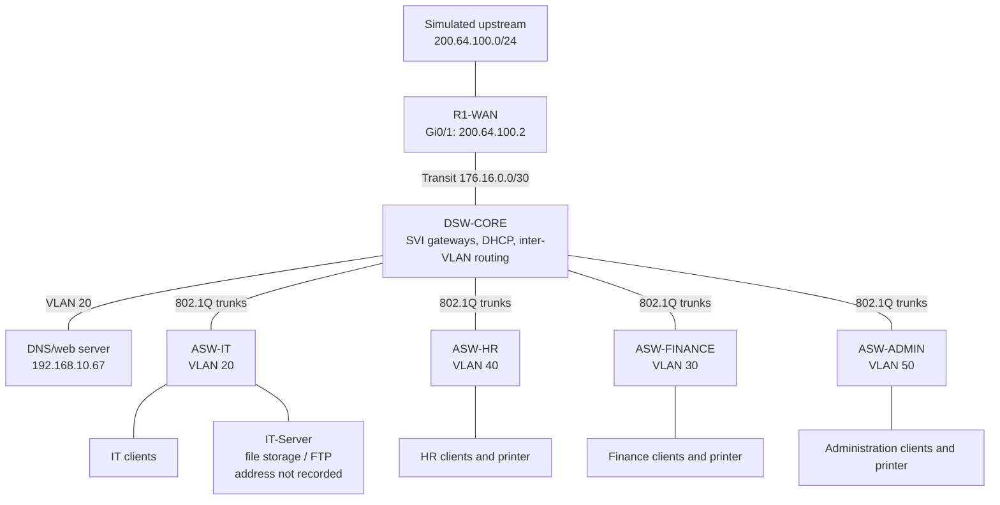

# Abyssinia Technologies PLC
## Enterprise Headquarters Network

A Cisco Packet Tracer project documenting a small, expandable headquarters
network for four departments: Administration, IT, Human Resources, and Finance.
The design uses department VLANs, Layer 3 switching, DHCP, a simulated WAN edge,
an IT file/FTP server, and a DNS/web server.

> **Project status:** The Packet Tracer simulation and supporting evidence are
> included. Some connectivity checks are demonstrated in screenshots; the
> remaining checks are explicitly marked as pending in the test report.

## At a glance

| Area | Design |
|---|---|
| Current / planned staff | 48 / 100 |
| Departments | Administration, IT, HR, Finance |
| Switching | One multilayer distribution switch and four access switches |
| Department VLANs | IT 20, Finance 30, HR 40, Administration 50 |
| Shared VLANs | Native 99, management 100 |
| Internal addressing | `192.168.10.0/24`, subnetted with VLSM |
| Routing and services | Inter-VLAN routing and DHCP on DSW-CORE; static routing and NAT on R1-WAN |
| Simulation | Cisco Packet Tracer; the upstream cloud is simulated |

## Architecture

The [Packet Tracer topology screenshot](packet-tracer/Topology.png) shows the
simulation workspace.

The multilayer switch provides departmental gateways and connects the access
switches, the DNS/web server, and the WAN router. Department VLANs are routed
by the core; the current configuration does not include ACLs to restrict
inter-department traffic. The IT-Server is intended for file storage over FTP;
its configured IP address and FTP functionality still need to be recorded and
verified.

## Evidence

The screenshots are captured from the Packet Tracer implementation. Each has a
descriptive filename and is indexed in the [evidence guide](evidence/README.md).

## Repository guide

| Path | Contents |
|---|---|
| [packet-tracer/](packet-tracer/) | Packet Tracer simulation, topology, and server page |
| [configs/](configs/) | Device configuration templates |
| [documentation/](documentation/) | Project overview, design report, and implementation procedure |
| [ip-addressing/](ip-addressing/) | VLSM calculations and device/address table |
| [testing/](testing/) | Test cases, observed results, and pending verification |
| [troubleshooting/](troubleshooting/) | Planned fault scenarios and verification status |
| [evidence/](evidence/) | Screenshots from the simulation |

## Reproduce the project

1. Open `packet-tracer/abyssinia-enterprise-network.pkt` in Cisco Packet Tracer.
2. Review the [address plan](ip-addressing/ip-addressing-table.csv) and device
   configurations in `configs/`.
3. Use the [implementation procedure](documentation/implementation-procedure.md)
   to check the topology and device settings.
4. Run the pending tests in
   [connectivity-tests.md](testing/connectivity-tests.md) and add genuine
   screenshots or command output before marking them verified.

The text configurations are reference templates. Replace local credential
placeholders before applying them. Before publishing or sharing the `.pkt`
file, review and rotate any credentials stored inside the simulation.

## Known limitations and next steps

- Verify same-VLAN client-to-client connectivity and repeat the inter-VLAN ping
  that showed one initial timeout.
- Verify DNS resolution by hostname; the current browser screenshot uses the
  server IP address and proves HTTP access, not DNS lookup.
- Record the IT-Server's configured address and test FTP login and file
  transfers from an authorized client.
- Validate upstream routing/NAT beyond the router's own simulated WAN interface.
- Add and test ACL policy, management-plane restrictions, and redundancy as
  future improvements.

See the [design report](documentation/network-design-report.md) for the
implementation details and [test report](testing/connectivity-tests.md) for
what has and has not been verified.
