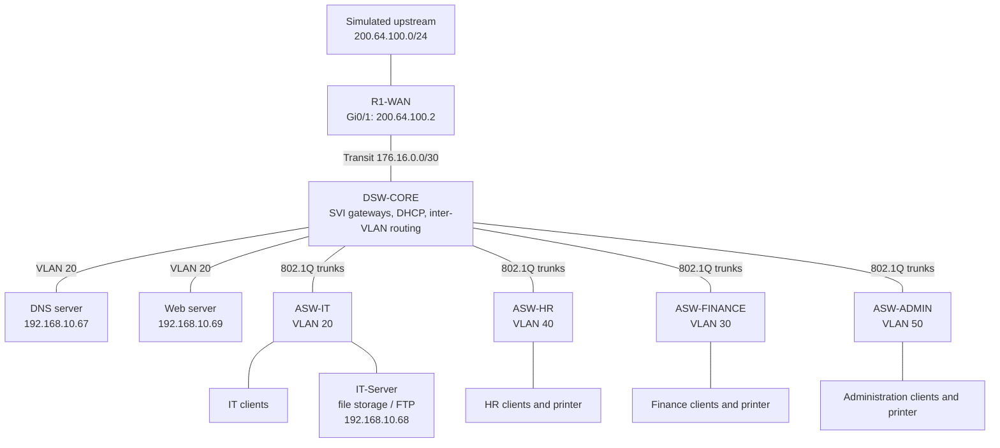

# Abyssinia Technologies PLC
## Enterprise Headquarters Network

A Cisco Packet Tracer project documenting a small, expandable headquarters
network for four departments: Administration, IT, Human Resources, and Finance.
The design uses department VLANs, Layer 3 switching, DHCP, a simulated WAN edge,
an IT file/FTP server, and separate DNS and web servers.

> **Project status:** The Packet Tracer simulation and supporting evidence are
> included. Some connectivity checks are demonstrated in screenshots; the
> remaining checks are explicitly marked as pending in the test report.

## At a glance

| Area | Design |
|---|---|
| Current / planned staff | 48 / 100 |
| Departments | Administration, IT, HR, Finance |
| Switching | One multilayer distribution switch and four access switches |
| Department VLANs | IT 20, Finance 30, HR 40, Administration 50 |
| Shared VLANs | Native 99, management 100 |
| Internal addressing | `192.168.10.0/24`, subnetted with VLSM |
| Routing and services | Inter-VLAN routing and DHCP on DSW-CORE; static routing and NAT on R1-WAN |
| Name-based web access | `www.abyssinia.com` resolves to the separate web server in the lab |
| Simulation | Cisco Packet Tracer; the upstream cloud is simulated |

## Architecture

### Topology device models

| Device / role | Packet Tracer model | Quantity |
|---|---|---:|
| WAN router (R1-WAN) | Cisco 2911 | 1 |
| Multilayer core switch (DSW-CORE) | Cisco 3560-24PS | 1 |
| Department access switches (ASW-IT, ASW-HR, ASW-FINANCE, ASW-ADMIN) | Cisco 2960-24TT | 4 |
| DNS, web, and FTP servers | Server-PT | 3 |
| Department client computers | PC-PT | 8 |
| Department printers | Printer-PT | 3 |
| Simulated upstream cloud | Cloud-PT | 1 |

The [full-size topology image](packet-tracer/Topology.png) shows the Packet
Tracer device model labels, departmental layout, servers, and network links.

The DNS server is configured with an A record for `www.abyssinia.com` pointing
to the web server at `192.168.10.69`. This is a lab DNS entry and does not
provide public DNS for the `.com` domain. The multilayer switch provides
departmental gateways and connects the access switches, separate DNS and web
servers, the FTP server, and the WAN router. The DSW-CORE reference
configuration includes a simple ACL that blocks other routed
networks from pinging IT hosts while allowing IT-initiated pings and all other
IP traffic. It does not block pings to the VLAN 20 gateway itself. The ACL
still needs to be applied to and tested in the Packet Tracer simulation.
The IT-Server provides file storage over FTP at `192.168.10.68`; a successful
login and directory listing are captured, while file upload/download still
needs verification.

## What is verified

| Area | Evidence-based status |
|---|---|
| DNS and web | FIN-PC1 loads `http://www.abyssinia.com`; the DNS record points to `192.168.10.69` |
| FTP | Client login and directory listing work; file transfers are not yet shown |
| Department pings | Reciprocal Admin pings are evidenced; IT, HR, and Finance peer targets need confirmation |
| VLAN 20 ACL | Included in the DSW-CORE template; Packet Tracer application and behavior remain unverified |
| WAN/NAT | Router interface checks are captured; reachability beyond the router is unverified |

## Evidence

The screenshots are captured from the Packet Tracer implementation. Each has a
descriptive filename and is indexed in the [evidence guide](evidence/README.md).

## Repository guide

| Path | Contents |
|---|---|
| [packet-tracer/](packet-tracer/) | Packet Tracer simulation, topology, and server page |
| [configs/](configs/) | Device configuration templates |
| [documentation/](documentation/) | Project overview, design report, and implementation procedure |
| [ip-addressing/](ip-addressing/) | VLSM calculations and device/address table |
| [testing/](testing/) | Test cases, observed results, and pending verification |
| [troubleshooting/](troubleshooting/) | Planned fault scenarios and verification status |
| [evidence/](evidence/) | Screenshots from the simulation |

## Reproduce the project

1. Open the confirmed final `.pkt` file from `packet-tracer/` in Cisco Packet Tracer.
2. Review the [address plan](ip-addressing/ip-addressing-table.csv) and device
   configurations in `configs/`.
3. Use the [implementation procedure](documentation/implementation-procedure.md)
   to check the topology and device settings.
4. Follow the [FTP server setup guide](documentation/implementation-procedure.md#5-set-up-the-ftp-server)
   to configure and test the IT file server.
5. Run the pending tests in
   [connectivity-tests.md](testing/connectivity-tests.md) and add genuine
   screenshots or command output before marking them verified.

Two `.pkt` files are currently in `packet-tracer/`. Compare them, choose the
intended final simulation, and remove or clearly label the backup before
sharing the project.

The text configurations are reference templates. Replace local credential
placeholders before applying them. Before publishing or sharing the `.pkt`
file, review and rotate any credentials stored inside the simulation.

## Known limitations and next steps

- Apply the VLAN 20 ping ACL in the Packet Tracer file and verify that
  other-VLAN pings to IT hosts are blocked while IT-initiated pings to other
  VLANs still work. The ACL does not block pings to the VLAN 20 gateway.
- Confirm each same-VLAN ping screenshot targets the other client's current IP;
  the IT-PC1 ping target matches IT-PC1's captured address.
- Verify FTP file upload and download from an authorized client; the captured
  evidence currently confirms login and directory listing only.
- Validate upstream routing/NAT beyond the router's own simulated WAN interface.
- Consider additional ACL policies, management-plane restrictions, and
  redundancy as future improvements.

See the [design report](documentation/network-design-report.md) for the
implementation details and [test report](testing/connectivity-tests.md) for
what has and has not been verified.
