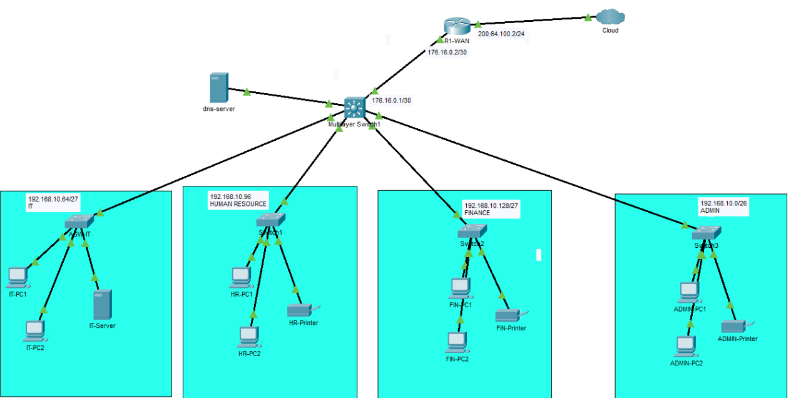

# Abyssinia Technologies PLC
## Enterprise Headquarters Network Design and Implementation

### Project Overview
This project focuses on designing and implementing a scalable enterprise network infrastructure for Abyssinia Technologies PLC.

The company has four departments:
- Administration
- Information Technology
- Human Resources
- Finance

The company currently has 48 employees and plans to expand to 100 employees.
## Architecture

### Project Objectives
1. Design a hierarchical enterprise network.
2. Apply IPv4 addressing and VLSM.
3. Configure network devices.
4. Test network connectivity.
5. Identify and resolve network faults.
6. Produce professional network documentation.

### Network Technologies
- IPv4 addressing
- VLSM subnetting
- Cisco switching
- Ethernet
- MAC address learning
- Cisco Packet Tracer

### Tools
- Cisco Packet Tracer
- Visual Studio Code
- Microsoft Excel (optional)
- Windows Command Prompt

### Project Structure
- packet-tracer/: Network simulation
- configs/: Device configurations
- documentation/: Technical reports
- ip-addressing/: Subnetting and IP allocation
- testing/: Connectivity test results
- troubleshooting/: Fault investigation records
- evidence/: Screenshots and implementation evidence

### Current Project Scope
This implementation covers:
- Physical enterprise topology
- IPv4 addressing and VLSM planning
- VLAN segmentation using department-based VLANs
- Inter-VLAN routing on the DSW-CORE switch
- DHCP services for departmental subnets
- Static DNS server configuration on the IT VLAN
- SSH access on all switches
- Static routing between the internal network and the WAN router
- Shutdown of unused switch ports

NAT, deeper WAN security controls, and OSPF are still planned for future enhancement phases.

### Project Status
Phase 2: VLAN-based enterprise network implementation with routing, DHCP, DNS, and SSH administration.
