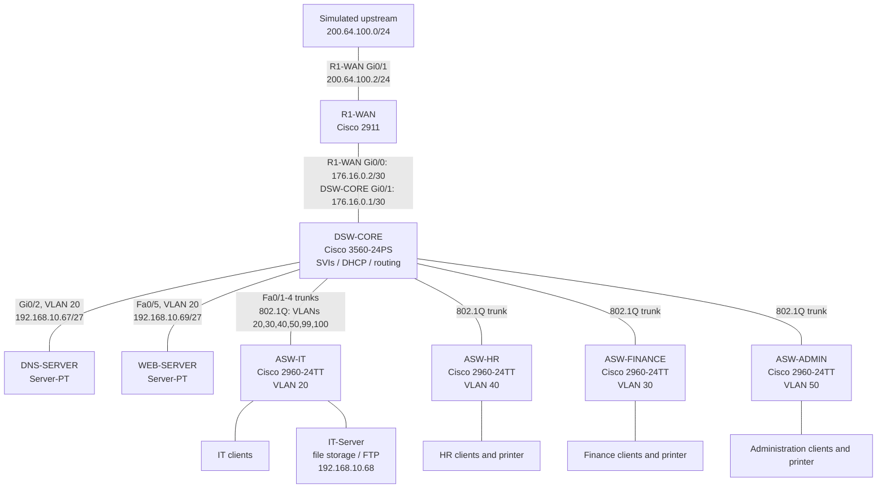

# Abyssinia Technologies PLC Enterprise Headquarters Network

**Overview:** This Cisco Packet Tracer lab demonstrates a segmented
four-department headquarters network and solves the need for managed
interdepartmental connectivity, shared DNS/web/file services, and a simple
policy that prevents other routed departments from pinging IT hosts.


> **Project status:** The Packet Tracer simulation and supporting evidence are
> included. Some connectivity checks are demonstrated in screenshots; the
> remaining checks are explicitly marked as pending in the test report.

## At a glance

| Area | Design |
|---|---|
| Current / planned staff | 48 / 100 |
| Departments | Administration, IT, HR, Finance |
| Switching | One multilayer distribution switch and four access switches |
| Department VLANs | IT 20, Finance 30, HR 40, Administration 50 |
| Shared VLANs | Native 99, management 100 |
| Internal addressing | `192.168.10.0/24`, subnetted with VLSM |
| Routing and services | Inter-VLAN routing and DHCP on DSW-CORE; static routing and NAT on R1-WAN |
| Name-based web access | `www.abyssinia.com` resolves to the separate web server in the lab |
| Simulation | Cisco Packet Tracer; the upstream cloud is simulated |

## Architecture



### Topology device models

| Device / role | Packet Tracer model | Quantity |
|---|---|---:|
| WAN router (R1-WAN) | Cisco 2911 | 1 |
| Multilayer core switch (DSW-CORE) | Cisco 3560-24PS | 1 |
| Department access switches (ASW-IT, ASW-HR, ASW-FINANCE, ASW-ADMIN) | Cisco 2960-24TT | 4 |
| DNS, web, and FTP servers | Server-PT | 3 |
| Department client computers | PC-PT | 8 |
| Department printers | Printer-PT | 3 |
| Simulated upstream cloud | Cloud-PT | 1 |

The [full-size topology image](packet-tracer/Topology.png) shows the Packet
Tracer device model labels, departmental layout, servers, and network links.
The Mermaid diagram adds the interface and IP details; access-layer links are
shown in the topology image.

### Key interfaces and addressing

| Device | Interface | Connection / VLAN | Address |
|---|---|---|---|
| DSW-CORE | GigabitEthernet0/1 | Routed link to R1-WAN | `176.16.0.1/30` |
| R1-WAN | GigabitEthernet0/0 | Routed link to DSW-CORE | `176.16.0.2/30` |
| R1-WAN | GigabitEthernet0/1 | Simulated upstream | `200.64.100.2/24`; next hop `.1` |
| DSW-CORE | VLAN 20 SVI | IT gateway | `192.168.10.94/27` |
| DSW-CORE | VLAN 30 SVI | Finance gateway | `192.168.10.158/27` |
| DSW-CORE | VLAN 40 SVI | HR gateway | `192.168.10.126/27` |
| DSW-CORE | VLAN 50 SVI | Administration gateway | `192.168.10.1/26` |
| DSW-CORE | VLAN 100 SVI | Switch management gateway | `192.168.10.193/27` |
| DSW-CORE | FastEthernet0/1-4 | 802.1Q trunks to access switches | VLANs 20, 30, 40, 50, 99, 100 |
| Access switches | GigabitEthernet0/1 | 802.1Q uplinks to DSW-CORE | Trunk; department VLAN and 99/100 |
| DSW-CORE | GigabitEthernet0/2 | DNS server, access VLAN 20 | `192.168.10.67/27` |
| DSW-CORE | FastEthernet0/5 | Web server, access VLAN 20 | `192.168.10.69/27` |
| IT-Server | Access port on ASW-IT | FTP server, VLAN 20 | `192.168.10.68/27` |

The DNS server is configured with an A record for `www.abyssinia.com` pointing
to the web server at `192.168.10.69`. This is a lab DNS entry and does not
provide public DNS for the `.com` domain. The multilayer switch provides
departmental gateways and connects the access switches, separate DNS and web
servers, the FTP server, and the WAN router. The DSW-CORE reference
configuration includes a simple ACL that blocks other routed networks from
pinging IT hosts while allowing IT-initiated pings and all other IP traffic.
Packet Tracer screenshots verify a denied ping from Administration to an IT
host and a successful ping from IT to an Administration host. The ACL does not
block pings to the VLAN 20 gateway itself.
The IT-Server provides file storage over FTP at `192.168.10.68`; a successful
login and directory listing are captured, while file upload/download still
needs verification.

## What is verified

| Area | Evidence-based status |
|---|---|
| DNS and web | FIN-PC1 loads `http://www.abyssinia.com`; the DNS record points to `192.168.10.69` |
| FTP | Client login and directory listing work |
| Department pings | Administration peer pings are evidenced; verify peer IPs before interpreting IT, HR, and Finance screenshots |
| VLAN 20 ACL | Verified for the tested hosts: Administration-to-IT ping is blocked; IT-to-Administration ping succeeds |
| WAN/NAT | Router interface checks are captured; reachability beyond the router is unverified |

## Technologies and protocols

- **Models:** Cisco 2911 router; Cisco 3560-24PS multilayer switch; four
  Cisco 2960-24TT access switches; Packet Tracer Server-PT, PC-PT, Printer-PT,
  and Cloud-PT devices.
- **Emulator/version:** Cisco Packet Tracer 9.0.1.
- **Switching and LAN:** VLANs 20/30/40/50, native VLAN 99, management VLAN 100,
  access ports, 802.1Q trunks, SVIs, and inter-VLAN routing.
- **Addressing and routing:** IPv4 VLSM, DHCP, directly connected routes, and
  statically configured routes. No dynamic routing protocol is configured.
- **Services:** DNS A record, HTTP, FTP, SSH, and ICMP echo testing.
- **Security policy:** Extended ACL on VLAN 20 denies routed ICMP echo requests
  to IT hosts; other IP traffic and IT-initiated pings are permitted. NAT
  overload is configured on R1-WAN for simulated upstream use.
- **OS images and hardware:** No external IOS/OS images or physical hardware
  are required; the lab uses Packet Tracer's built-in device models and
  emulated services.

## Evidence

The screenshots are captured from the Packet Tracer implementation. Each has a
descriptive filename and is indexed in the [evidence guide](evidence/README.md).

## Repository guide

| Path | Contents |
|---|---|
| [packet-tracer/](packet-tracer/) | Packet Tracer simulation, topology, and server page |
| [configs/](configs/) | Device configuration templates |
| [documentation/](documentation/) | Project overview, design report, and implementation procedure |
| [ip-addressing/](ip-addressing/) | VLSM calculations and device/address table |
| [testing/](testing/) | Test cases, observed results, and pending verification |
| [troubleshooting/](troubleshooting/) | Planned fault scenarios and verification status |
| [evidence/](evidence/) | Screenshots from the simulation |

```text
.
|-- README.md
|-- configs/                 # IOS configuration reference templates
|-- documentation/           # Overview, design, and deployment procedure
|-- evidence/                # Packet Tracer screenshots (not PCAP captures)
|-- ip-addressing/           # VLSM calculations and address CSV
|-- packet-tracer/           # .pkt simulations, topology image, server HTML
|-- testing/                 # Connectivity test matrix and results
`-- troubleshooting/         # Incident history and fixes
```

## Prerequisites

- Cisco Packet Tracer 9.0.1 installed. Confirm both supplied `.pkt` files open
  before editing; use this version for the closest match to the lab.
- No downloaded IOS images, separate OS images, physical network hardware,
  or third-party packages are needed.
- Review the `.pkt` files for lab credentials before publishing or sharing.

## Deployment

1. Download or clone this repository and open `packet-tracer/` in your file
   browser.
2. There are two simulation files:
   `abyssinia-enterprise-network.pkt` and
   `abyssinia-enterprise-network1.pkt`. Open each in Packet Tracer, compare
   their contents, and choose the intended final version; do not assume which
   is current based on its name.
3. Open the selected topology and inspect device models, links, VLANs, and
   addressing. Save a separate working copy before making changes.
4. Open the matching text template in `configs/` for each router or switch.
   From that device's CLI, enter privileged/configuration mode as needed and
   apply the commands in the template. Replace credential placeholders with
   unique lab values; avoid blindly reapplying commands if the running
   configuration already differs.
5. Configure Packet Tracer server services through each server's **Desktop**
   and **Services** tabs as described in the
   [implementation procedure](documentation/implementation-procedure.md).
6. Save the working `.pkt` file, then run the checks in the
   [connectivity test report](testing/connectivity-tests.md).

## Verification and testing

Run on end devices as appropriate:

```text
ipconfig
ping <same-VLAN-peer-ip>
ping <other-VLAN-peer-ip>
ping 192.168.10.94
ping 192.168.10.69
ping www.abyssinia.com
ftp 192.168.10.68
```

Run on DSW-CORE/R1-WAN as appropriate:

```text
show ip interface brief
show vlan brief
show interfaces trunk
show spanning-tree
show cdp neighbors detail
show ip route
show access-lists IT-INBOUND-PING-RESTRICTION
show ip nat translations
```

For the ACL, verify both directions: ping an IT host from another VLAN (should
be blocked), then ping a host in another VLAN from IT (should succeed). The ACL
is attached to the VLAN 20 SVI and does not block pinging the VLAN 20 gateway.
Capture actual results and update the
[test report](testing/connectivity-tests.md); do not mark a test verified based
only on the configured policy.

The text configurations are reference templates. Replace local credential
placeholders before applying them. Before publishing or sharing the `.pkt`
file, review and rotate any credentials stored inside the simulation.

