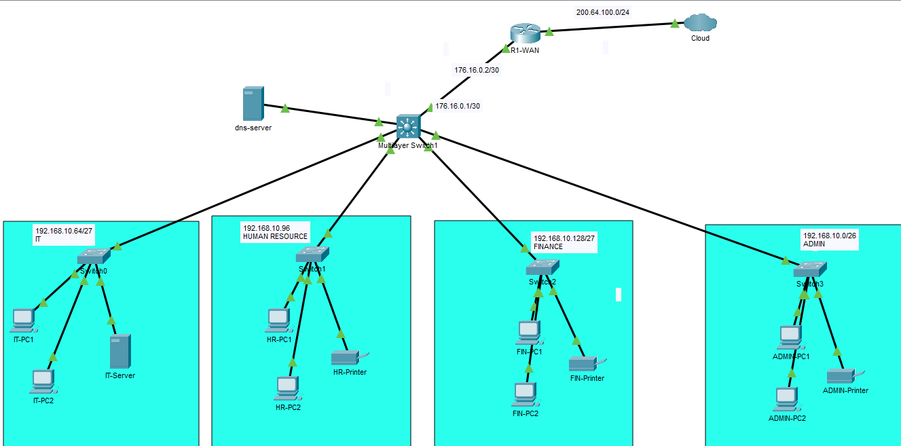
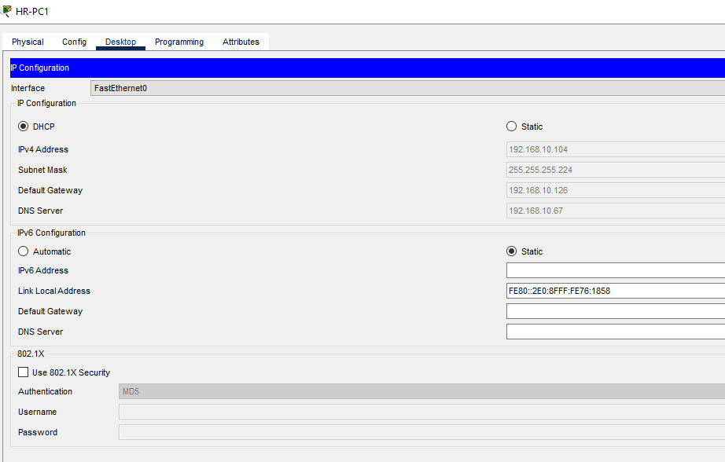
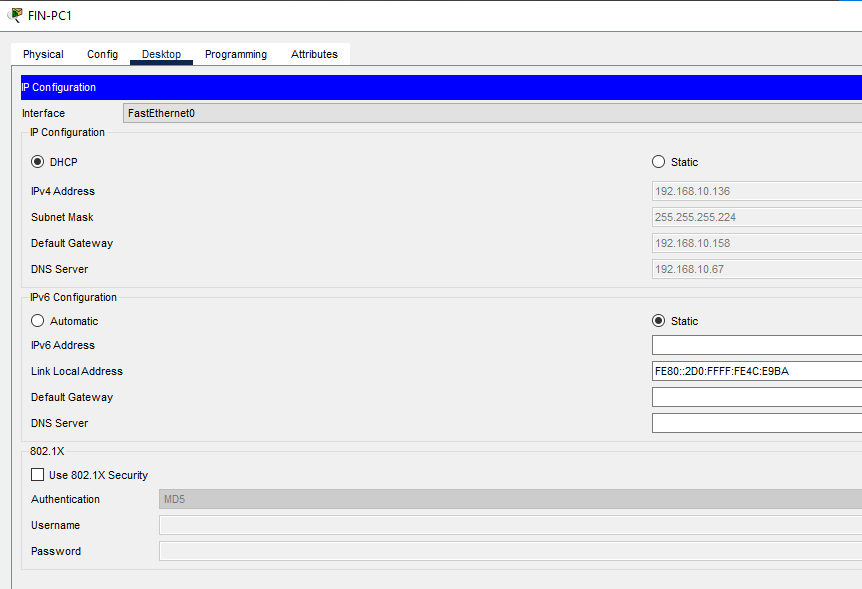
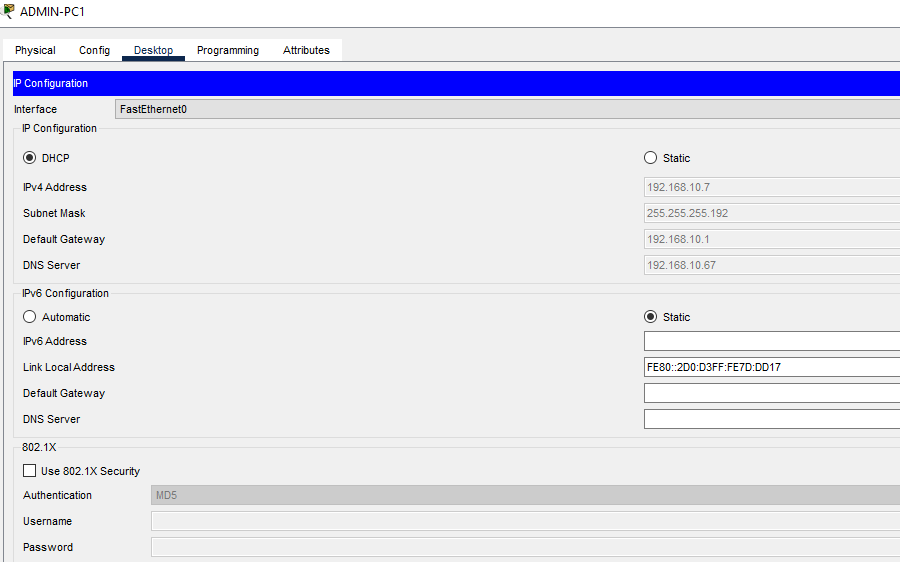
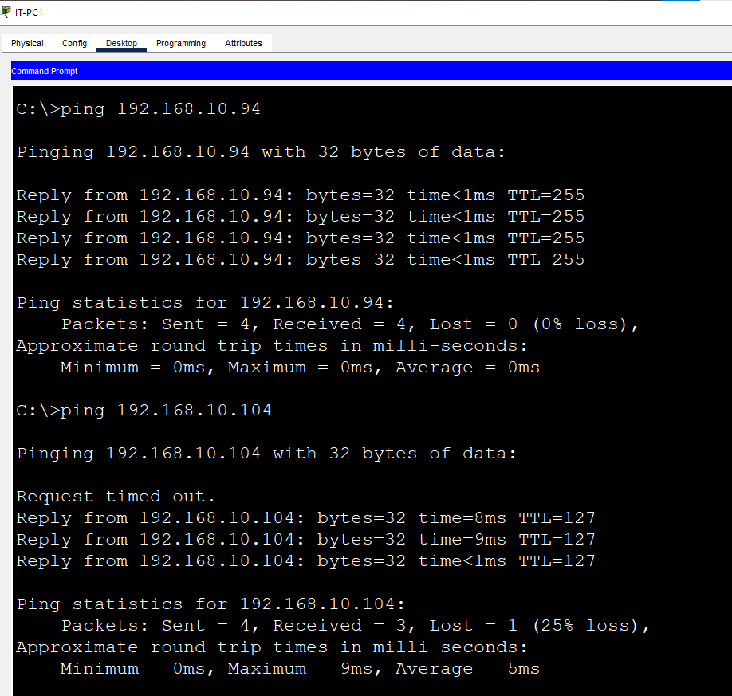
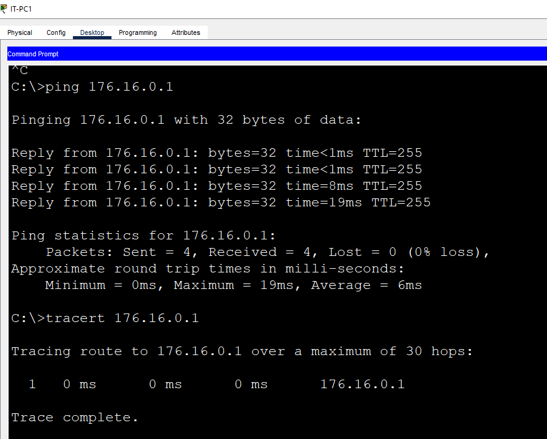
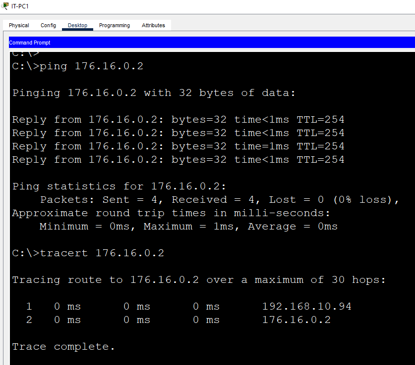
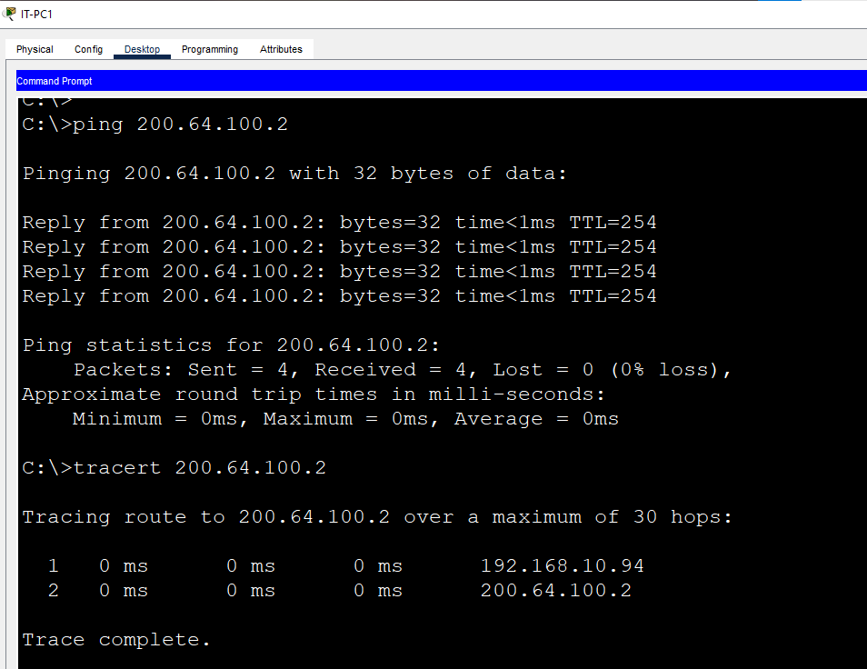

# Project Evidence

05-successful-ping.png
06-failed-cross-subnet-ping.png
07-switch-mac-address-table.png
08-switch-interface-status.png
09-incorrect-mask.png
10-corrected-mask.png
11-duplicate-ip-test.png

Do not use sample or fabricated screenshots.
Capture evidence from your actual implementation.
